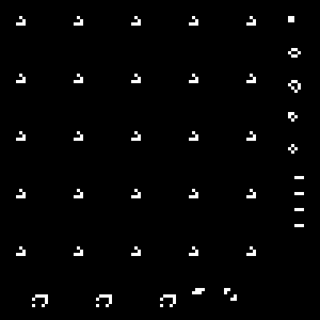

# Laboratorio 2: Conway's Game of Life

Implementación del Juego de la Vida de Conway en Rust con [raylib](https://github.com/raylib-rs/raylib-rs). El estado se guarda en un framebuffer de 100x100 pixeles que se dibuja en una ventana de 800x800, con cada celda como un punto del framebuffer.

## Resultado



El GIF muestra las primeras 300 generaciones a 10 FPS, escalado a 400x400. Se generó a partir del framebuffer de la simulación, con el mismo patrón inicial y las mismas reglas de `main.rs`.

## Reglas

En cada generación, `next_generation` calcula el estado completo a partir de los 8 vecinos de cada celda:

- Una celda viva con 2 o 3 vecinos vivos sobrevive.
- Una celda muerta con exactamente 3 vecinos vivos nace.
- En cualquier otro caso, la celda queda muerta (subpoblación o sobrepoblación).

## Patrón inicial

| Tipo | Organismos |
| --- | --- |
| Still lifes | Block, beehive, loaf, boat, tub |
| Osciladores | Blinker, toad, beacon |
| Spaceships | Glider (cuadrícula de 5x5), LWSS |

## Cómo correrlo

Se necesita Rust y las dependencias de compilación de raylib (CMake y un compilador de C).

```bash
cd game_of_life
cargo run --release
```

La ventana se cierra con `Esc`.
